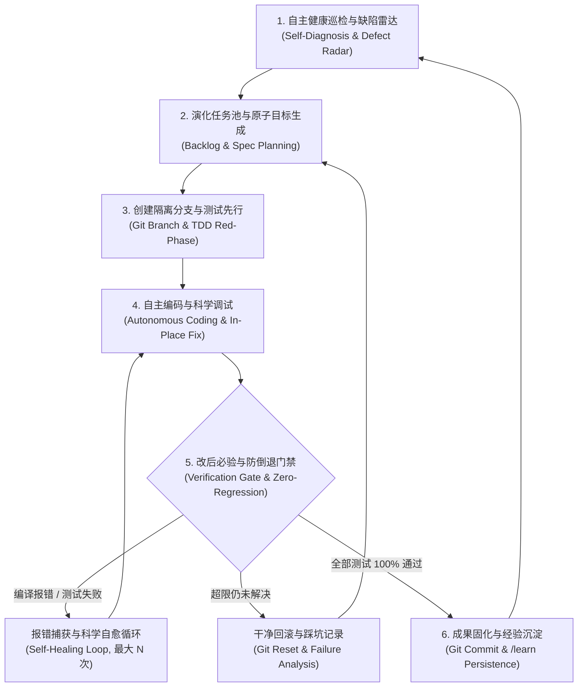

# DeepAutoCode 自举与自主进化系统方法论
> **DeepAutoCode Bootstrapping & Recursive Self-Improvement (RSI) Specification**
> 
> *版本: v1.1.0*  
> *适用范围: DeepAutoCode IDE Workbench (`deepautocode`) & Agent Runtime (`deepautocode-agent`)*

---

## 1. 核心理论与自举本质 (Core Philosophy & Paradigm)

### 1.1 什么是软件自举（Self-Hosting）与 AI 自主进化
在计算机工程史上，**自举（Self-Hosting）** 是衡量系统成熟度的终极里程碑——例如经典的 C 语言编译器（GCC、Clang）能够“用自己写自己、用自己编译自己”。

在现代 Agentic AI 时代，自举演进为**自主循环进化（Recursive Self-Improvement）**：
AI 辅助编程系统不仅是一个被动的代码编辑器，而是一个能够将**自身代码库作为工作区（Workspace）**，通过自主观察、诊断、提出假设、编写测试、实施修改、编译构建、报错自愈与知识沉淀的闭环工程系统。

### 1.2 DeepAutoCode 具备自举进化的核心基石
DeepAutoCode 自身由强类型语言和模块化架构构建（TypeScript + Vite + Electron + Node.js），并内置了完整的智能体工具链：
1. **多维代码感知能力**：`read_files`（行号范围批读）、`outline_file`（符号大纲提取）、`search_codebase`（全文检索）。
2. **手术式原地修改能力**：`edit_file`（精准匹配替换）、`write_file`（原子写入）。
3. **真实环境交互能力**：`run_command`（执行编译、构建、测试套件与 Git 操作）。
4. **前端视觉与 DOM 探查能力**：`browser_action`（自主检测运行中的 Webview DOM 结构、交互组件与控制台报错）。
5. **科学调试与自愈引擎**：四阶段问题排查协议（Phase 1~4）与改后必编译验证防护栏。
6. **知识持久化能力**：`/learn` 机制与 `.agents/rules/` 规范沉淀。

---

## 2. 自主进化六步飞轮闭环 (The 6-Phase Evolution Flywheel)

为确保系统在自我迭代过程中**绝不会破坏现有功能或引起主进程崩溃（Crash the host）**，自举流程必须严格遵循以下六步闭环：



---

### 阶段一：自主健康巡检与缺陷雷达 (Defect Radar & Health Check)

系统通过自动化扫描发现自身的潜在缺陷与演进空间，雷达覆盖四个维度：

1. **静态代码质量与类型健康**：
   - 运行 TypeScript 类型编译器：`tsc --noEmit`，扫描潜在类型漏洞（如 `any` 蔓延、未处理的联合类型）。
   - 依赖与废弃 API 审计：检查是否有弃用接口调用、未捕捉的 Promise rejection。
2. **测试网健全度与耗时审计**：
   - 运行全量测试套件（`vitest run`），分析用例执行耗时，定位接近超时阈值的慢测试（如耗时 > 5000ms 的边缘用例）。
   - 检查是否有未覆盖的异常分支（Uncovered Catch Blocks）。
3. **运行时日志与用户行为审计**：
   - 解析历史会话转录日志（`transcript.jsonl`），统计高频报错工具、重试次数偏高的操作。
   - 统计用户在 Diff 审查中的“拒绝修改（Reject Diff）”行为，识别模型决策偏差。
4. **业界前沿能力对齐雷达**：
   - 对标 Google Antigravity、Cursor、Claude Code 的最新基准特性（如多模态探查、行内幽灵补全、工作流斜杠指令等），输出差距清单。

---

### 阶段二：演化任务池与原子目标拆解 (Evolution Backlog & Slicing)

自我进化严禁“大包大揽”，每次迭代必须遵循**原子目标原则（Single Responsibility Iteration）**，任务划分为三类：

| 任务类型 | 演进目标示例 | 风险等级 | 准入要求 |
| :--- | :--- | :--- | :--- |
| **Bug Fix (缺陷修复)** | 修复 `sed -n` 截断读取时大括号未闭合问题 | 低 | 必须提供重现失败的单元测试用例 |
| **Performance (性能优化)** | 为文件大纲解析增加 LRU 缓存，降低重复读取开销 | 中 | 必须提供 Benchmark 耗时对比数据 |
| **Feature (新特性开发)** | 新增 `/benchmark` 斜杠工作流，支持一键性能基准测试 | 中 | 必须包含端到端集成测试与用户使用文档 |

---

### 阶段三：隔离分支与测试驱动先行 (Isolated Git Branch & TDD)

为确保主分支绝对安全，实施**红灯先行（Red Phase）**策略：

1. **环境与分支隔离**：
   - 自动拉取独立开发分支：
     ```bash
     git checkout -b evolve/<task-category>-<task-name>
     ```
2. **测试用例先行（TDD Red Phase）**：
   - 在修改或编写任何业务逻辑前，**先编写一个能够稳定复现该缺陷或覆盖该新功能的测试用例**。
   - 运行测试，确保该测试此时处于**失败状态（Failed）**，证明测试用例有效且非虚假通过。

---

### 阶段四：科学调试与最小侵入式开发 (Scientific Dev & Debugging)

遵循 DeepAutoCode 独有的 **4-Phase 科学排查协议**：

1. **并发精准取证**：
   - 严禁盲目猜测，优先使用 `outline_file` 定位符号区间，配合 `read_files` 并发读取函数上下文。
2. **严守函数完整性铁律**：
   - 严禁只读前半段代码，必须从函数签名完整阅读至闭合大括号 `}`，仔细审查尾部边界与异常分支。
3. **唯一根因收敛**：
   - 结合数据结构不变量与数学边界推演，收敛到唯一明确的技术方案，避免多选摇摆。
4. **最小侵入式修改**：
   - 使用 `edit_file` 原地修改最关键的代码行，严禁无故大面积重构不相关代码，保护注释与文档完整性。

---

### 阶段五：改后必验与防倒退门禁 (Verification & Zero-Regression Gate)

这是系统自我进化的**核心安全屏障**。修改完成后必须连续通过四道门禁：

```text
[代码修改完成]
      │
      ▼
┌──────────────────────────────────────┐
│  门禁 1: 全局编译门禁 (tsc & vite)    │ ─── 失败 ──► 触发编译器报错自愈 (Self-Healing)
└──────────────────────────────────────┘
      │ 通过
      ▼
┌──────────────────────────────────────┐
│  门禁 2: 存量测试零倒退 (100% 保持通过)│ ─── 失败 ──► 立即回滚侵入性修改，重新分析
└──────────────────────────────────────┘
      │ 通过
      ▼
┌──────────────────────────────────────┐
│  门禁 3: 新增测试绿灯 (TDD Green)    │ ─── 失败 ──► 补充边界修补
└──────────────────────────────────────┘
      │ 通过
      ▼
┌──────────────────────────────────────┐
│  门禁 4: 熔断保护与干净回滚机制       │
└──────────────────────────────────────┘
```

- **自愈循环限制**：单次任务的自动修复重试次数上限为 **5 次**。
- **安全熔断（Circuit Breaker）**：如果连续 5 次自愈仍无法全量通过测试，触发安全熔断，执行：
  ```bash
  git checkout .
  git clean -fd
  ```
  干净回滚工作区，同时将本次失败的代码方案、错误栈与假设缺陷记录至《自演化避坑日志》（`EVOLUTION_BLOCKERS.md`），确保模型不再踩同一个坑。

---

### 阶段六：成果固化与经验沉淀 (Commit & Knowledge Loop)

当全部门禁通过后，系统完成最后收尾与自我沉淀：

1. **语义化 Git 提交**：
   - 生成规范化提交记录：
     ```bash
     git commit -m "evolve(runtime): support debounced ghost text with memory-bounded cache"
     ```
2. **工程知识沉淀（/learn 机制）**：
   - 自动提炼本次迭代中的架构认知与踩坑经验，沉淀到 `.agents/rules/` 规则文件中。
   - 更新系统版本变更日志（`CHANGELOG.md`）。

---

## 3. 落地实践指南 (Practical Operation Guide)

### 方案 A：在 DeepAutoCode IDE 内部自举开发（推荐日常使用）

1. **启动 DeepAutoCode**：
   双击运行根目录的 `start-desktop.bat` 启动 IDE。
2. **打开自身源码工程**：
   在顶部菜单栏点击 `File -> Open Folder`，选择当前目录：
   ```text
   G:\AutoCode\DeepAutoCode
   ```
3. **通过 `/goal` 激发自愈闭环**：
   在右侧 AI 对话面板中下达结构化指令：
   ```text
   /goal 检查 deepautocode-agent 中的工具策略与超时配置，为慢测试添加自适应超时防护，编写测试用例验证，并确保 npm run build 和 npm test 全部 100% 通过。
   ```
4. **观察自举执行**：
   你将看到 DeepAutoCode 读取自身源码、定位问题、打补丁、调用终端执行 `npm test`、观察测试输出并在通过后汇报详细报告。

---

### 方案 B：后台自动化演进管线（Evolution Pipeline Runner）

为了实现无人值守的自动化巡检与迭代，可以在 `scripts/` 下配置演化守护进程脚本：

```typescript
// scripts/self-evolution-runner.ts 架构概念
export async function runEvolutionCycle() {
  console.log("==> 1. Running Diagnostic Health Check...");
  const baseline = await runCommand("npm test");
  if (!baseline.success) {
    console.error("Baseline broken, initiating auto-repair first!");
  }

  console.log("==> 2. Picking Next Priority Backlog Item...");
  // 读取 .agents/backlog/ 挑选优先级最高的问题

  console.log("==> 3. Creating Isolated Branch...");
  await runCommand("git checkout -b evolve/auto-refactor");

  console.log("==> 4. Executing Agent TDD Loop via AgentClientBridge...");
  // 驱动 AgentBridge 进行定向编码与自愈

  console.log("==> 5. Strict Verification Gate...");
  const buildRes = await runCommand("npm run build");
  const testRes = await runCommand("npm test");

  if (buildRes.success && testRes.success) {
    console.log("==> 6. Commit & Merge candidate ready!");
    await runCommand('git commit -m "evolve: autonomous optimization verified"');
  } else {
    console.warn("==> Circuit Breaker: Rolling back changes cleanly.");
    await runCommand("git reset --hard HEAD");
  }
}
```

---

## 4. 安全红线与防御边界 (Safety Guardrails & Boundaries)

自举开发必须设置不可逾越的安全红线：

1. **环境凭据隔离**：严禁模型将真实的 `.env`、API Key、SSH 私钥写入任何提交或公开文件；所有测试必须使用 Mock 或环境变量抽象。
2. **保护 Git 核心历史**：严禁执行 `git push --force` 或破坏已有提交图；所有自动化代码必须通过独立分支或 Pull Request 进入主干。
3. **进程生命周期保护**：正在运行的 IDE 宿主进程保护自身的关键运行时环境（如 `server.ts` 监听端口与底层 IPC 桥），代码修改仅作用于文件系统，重启热加载由构建工具安全接管。

---

## 5. 自我进化成熟度模型 (Evolution Maturity Model)

```text
Level 1: 辅助自举 (Copilot Mode)
  └─ 人工指定具体文件与修改点，Agent 负责写代码，人工点击确认并运行测试。

Level 2: 目标驱动自举 (Goal-Oriented Dogfooding) - [当前 DeepAutoCode 达到的能力]
  └─ 用户通过 /goal 指明宏观需求，Agent 自主进行“取证 -> 编辑 -> 编译 -> 测试 -> 报错自愈”闭环。

Level 3: 全自动安全演化 (Continuous Autonomous Evolution)
  └─ 系统配备后台自检守护器，夜间或空闲时自主巡检代码缺陷、生成测试、自我优化并产出演进报告。
```

---

*本文档持久保存在 `doc/BOOTSTRAPPING-AND-SELF-EVOLUTION.md`，作为 DeepAutoCode 系统工程演化的核心指导规范。*
